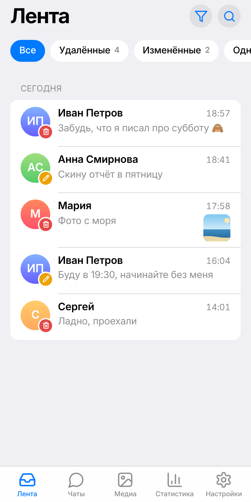
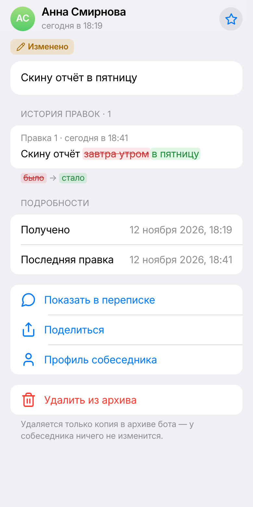
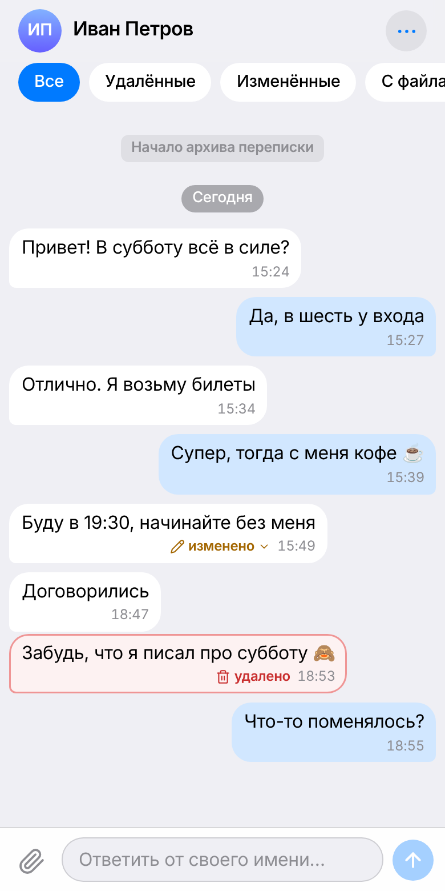
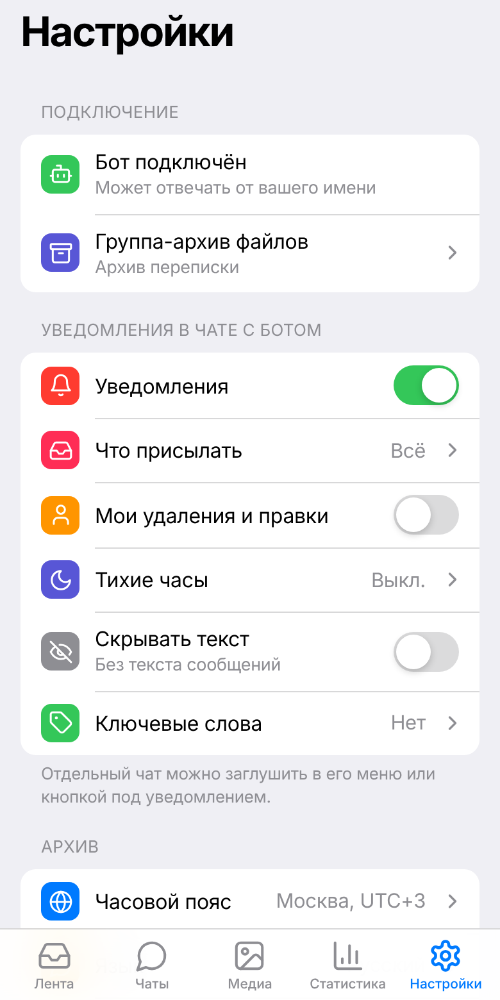

# tg-message-archive

Telegram-бот и Mini App, которые сохраняют удалённые и изменённые сообщения в личных чатах
вашего аккаунта и показывают их в приложении внутри Telegram. Работает на
[Telegram Serverless](https://core.telegram.org/bots/serverless) — без своего сервера и базы.

<p align="center">
  
  
  
  
</p>
<p align="center"><sub>Скриншоты сняты на демонстрационных данных.</sub></p>

Одним инстансом могут пользоваться несколько человек: каждый подключает бота к своему аккаунту
и видит только свои данные. Telegram Premium не нужен.

## Содержание

- [Возможности](#возможности)
- [Приватность и ответственность](#приватность-и-ответственность)
- [Как это устроено](#как-это-устроено)
- [Свой инстанс](#свой-инстанс)
- [Что и когда удаляется](#что-и-когда-удаляется)
- [Лимиты](#лимиты)
- [Разработка](#разработка)
- [Документация](#документация)
- [Участие в разработке](#участие-в-разработке)
- [Безопасность](#безопасность)
- [Лицензия](#лицензия)

## Возможности

### Архив

- Удалённые сообщения и правки с полной историей версий и пословным сравнением «было → стало».
- Одноразовые фото, видео и голосовые: ответьте на такое сообщение до того, как откроете его, —
  бот сохранит оригинал, пока он не исчез.
- Копии файлов в закрытой группе-архиве: отдельная тема на каждого собеседника, пересылка по
  `file_id` без ограничения размера. Подпись копии обновляется при удалении и правке.
- Ключевые слова: уведомление, когда во входящем встретилось слово из вашего списка — частью
  слова или целым словом, со словами-исключениями.

### Mini App

- Лента событий с фильтрами, бесконечной прокруткой и обновлением на лету.
- Переписка с подсветкой удалённого, фильтрами и поиском внутри чата.
- Медиа-галерея: превью и файлы до 20 МБ открываются в приложении, более крупные бот присылает
  в чат или показывает в группе-архиве.
- Поиск по всему архиву и профиль собеседника с его статистикой.
- Статистика за 7, 30, 90, 365 дней или свой период, по всем чатам или одному: сравнение с
  прошлым периодом, активность и всплески удалений, тепловая карта «день × час», время от
  отправки до удаления, хроника массовых удалений, баланс переписки и время ответа, что удаляют
  чаще, частые слова из удалённого, рекорды.
- Ответ собеседнику из приложения, в том числе с цитатой и файлом. Нужно право `can_reply`;
  Telegram даёт на ответ 24 часа.
- Экспорт в JSON, CSV, Markdown и HTML — файлом в чат с ботом.
- Замок приложения: биометрия или PIN-код, автоблокировка.
- Русский и английский язык — по языку Telegram или по выбору в Настройках.

### Уведомления

- Бот сам пишет в личный чат об удалении, правке, одноразовом медиа, ключевом слове и смене
  имени или username собеседника.
- Серия удалений в одном чате собирается в одно сообщение; массовое удаление и очистка всего
  чата отмечаются отдельно, при очистке бот прикладывает архив переписки файлом.
- Кнопки под уведомлением: открыть в приложении, добавить в избранное, заглушить чат, ответить,
  убрать из архива.
- Настройки: виды событий по отдельности, тихие часы, скрытие текста сообщений, тишина по
  отдельному чату.

### Управление данными

- Исключённые чаты не сохраняются. Можно выбрать, какие типы файлов и какого размера копировать
  в группу-архив.
- Срок хранения: всегда, год, 90 или 30 дней. Избранное не удаляется.
- Удаление истории чата за сегодня или за три дня, переписки с собеседником целиком, всего
  архива; автоудаление после отключения бота.
- Отметка прочтения от имени аккаунта: не трогать, все чаты или выбранные.
- Команды бота: `/stats`, `/export`, `/mute`, `/pause`, `/delete_me` и другие — полный список
  по `/help`.

### Для оператора

- Журнал ошибок, уведомления оператору, команда `/admin` и раздел «Оператор» в приложении.
- Самопроверка на платформе после каждого деплоя.
- Подписка Pro за Telegram Stars встроена, но выключена: пока оператор не задал цену, все
  возможности доступны всем. Подробности — [docs/plans.md](docs/plans.md).

## Приватность и ответственность

Собеседник **не получает уведомления** о том, что его удалённые и изменённые сообщения
сохраняются. Данные изолированы по владельцу, но оператор инстанса технически хранит чужую
личную переписку и файлы — в базе бота и в группе-архиве. Используйте проект ответственно:
законы о тайне переписки различаются по странам.

Что именно стирают кнопки и команды удаления — в разделе
[Что и когда удаляется](#что-и-когда-удаляется).

## Как это устроено

```text
Telegram  ──webhook──▶  Telegram Serverless
                         ├─ handlers/      события бизнес-чатов: сохранение, удаления, правки
                         ├─ endpoints/     API для Mini App (initData проверяет платформа)
                         ├─ lib/           логика: архив, копии в группу, уведомления, поиск
                         ├─ schema.js      база бота (SQLite платформы)
                         └─ dist/          собранный Mini App (app<id>.tgcloud.ai)
```

- **Бэкенд** — модули JavaScript на платформе Telegram. Апдейты приходят на вебхук, которым
  платформа управляет сама. Файлы копируются в закрытую группу с темами, по теме на
  собеседника.
- **Уведомления** бот отправляет сам: Rich-сообщениями Bot API, а где они недоступны — обычным
  HTML.
- **Mini App** — приложение на React и Vite, которое платформа размещает рядом с ботом.

Сохраняются только личные чаты один на один, только с момента подключения бота и только те
чаты, которые вы разрешили боту в настройках Telegram.

## Свой инстанс

Сервер и база не нужны: всё работает на платформе Telegram, а выкладывает код GitHub Actions.
Компьютер тоже не обязателен — достаточно браузера и Telegram.

**Подробная пошаговая инструкция — [docs/deploy.md](docs/deploy.md).** Коротко:

1. Создайте бота в [@BotFather](https://t.me/BotFather), включите ему **Business Mode** и
   **Serverless**, возьмите CLI-токен (Serverless → CLI Access → Access token).
2. Сделайте форк репозитория и включите в нём Actions.
3. Сохраните токен секретом `TGCLOUD_TOKEN` (Settings → Secrets and variables → Actions).
4. Запустите деплой: Actions → Deploy to Telegram Serverless → Run workflow. Он выложит код и
   Mini App, создаст таблицы, настроит вебхук и кнопку меню бота и проверит себя на платформе.
5. Включите Mini App в профиле бота (@BotFather → Bot Settings → Configure Mini App) с адресом
   `https://app<id>.tgcloud.ai/`, где `app<id>` — начало токена до двоеточия.
6. Подключите бота к своему аккаунту: **Настройки → Аккаунт → Автоматизация чатов** (в старых
   версиях Telegram — «Telegram для бизнеса → Чат-боты») и откройте Mini App.

В коде нет ничего, что привязано к конкретному боту. Адрес Mini App и оператор хранятся в базе
инстанса и задаются при деплое: из секрета `TGCLOUD_TOKEN` и необязательных переменных
репозитория `OPERATOR_ID` и `APP_URL`. Без секрета деплой ничего не выкладывает.

## Что и когда удаляется

| Действие | Что удаляется | Что остаётся |
|----------|---------------|--------------|
| Срок хранения (Настройки → Архив) | сообщения старше срока, кроме избранного | всё остальное |
| «Удалить историю» в переписке (сегодня / 3 дня) | сообщения этого чата за период | остальные чаты |
| «Удалить переписку» в профиле собеседника | **всё об этом собеседнике**: сообщения, правки, файлы, поиск, статистика, настройки чата, его уведомления в очереди и фоновые задачи; по выбору — и тема в группе-архиве со всеми копиями | остальные чаты; копии в группе, если их не выбрали |
| «Удалить все мои данные» в приложении | все сообщения, правки, настройки чатов | подключение, настройки, группа-архив |
| Команда `/delete_me` в чате с ботом | **всё о владельце**: сообщения, правки, настройки, подключение, привязка группы, очередь уведомлений | копии файлов в вашей группе-архиве |
| «После отключения бота» (Настройки → Приватность) | то же, что `/delete_me`, через 7, 30 или 90 дней после отключения бота от аккаунта; по умолчанию выключено | копии файлов в группе-архиве |

Копии в группе-архиве бот сам не удаляет: группа принадлежит вам, удалите её в Telegram.
Исключение — «Удалить переписку» с выбором «и копии в группе-архиве»: тогда бот удаляет тему
собеседника вместе с копиями. Для этого ему нужно право «Удаление сообщений» в группе; новые
группы получают его при подключении.

Переписка удаляется только из архива бота. У собеседника в Telegram ничего не меняется, а
если он напишет снова, новые сообщения начнут сохраняться заново.

## Лимиты

- Копирование в группу-архив по `file_id` не ограничено размером файла.
- Открыть файл в приложении можно до 20 МБ — это лимит `getFile` в Bot API.
- В группу Telegram принимает около 20 сообщений в минуту, поэтому всплески копий бот
  растягивает очередью.
- Лимиты базы платформы в её документации не опубликованы — на этот случай есть настраиваемый
  срок хранения.

## Разработка

Нужен Node.js 20 или новее.

```bash
npm install
npm run lint        # ESLint
npm run typecheck   # tsc: серверная часть (JSDoc) и Mini App
npm test            # Vitest: бэкенд на локальной замене sdk, фронтенд в jsdom
npm run coverage    # покрытие tgcloud/lib, отчёт в coverage/
npm run build       # сборка Mini App в dist/
npm run e2e         # Playwright: собранный dist/ на мок-Telegram
npm run deploy      # сборка и tgcloud push
npm run migrate     # применить изменения схемы к базе (интерактивно)
npm run admin       # команды оператора, см. tgcloud/lib/admin.js
```

Для `npm run e2e` один раз установите браузер: `npx playwright install chromium`. Команды
`deploy`, `migrate` и `admin` обращаются к платформе, им нужен `TGCLOUD_TOKEN` в окружении или
`npx tgcloud login`.

### Стек

Telegram Serverless и `@tgcloud/cli` · SQLite платформы со схемой в стиле Drizzle · React и
Vite для Mini App · Vitest и Playwright для тестов. Локально платформенный `sdk` заменяет
`sdk-shim/` на Drizzle и libsql.

### Структура

```text
tgcloud/                 всё, что исполняет платформа
├─ schema.js             таблицы базы бота
├─ handlers/             обработчики апдейтов: business_connection, business_message,
│                        edited_business_message, deleted_business_messages, message,
│                        callback_query, my_chat_member, pre_checkout_query
├─ endpoints/            функции, которые вызывает Mini App
└─ lib/                  логика: events, runtime, archive, jobs, export, commands, plans, admin,
                         i18n, text, media, view, links, insights, util, repo/
web/                     исходники Mini App, собираются в dist/
sdk-shim/                локальная замена платформенного sdk для тестов и tsc
tests/                   Vitest; tests/e2e — Playwright
scripts/                 write-version.mjs (версия сборки), admin.mjs (команды оператора)
docs/                    документация
.github/workflows/       ci.yml — проверки, deploy.yml — выкладка
```

Платформа принимает не больше 100 модулей в `tgcloud/`: сверх этого `tgcloud push` отклоняет
выкладку целиком. Сейчас модулей 50, `tests/modules.test.ts` следит за пределом.

## Документация

| Документ | О чём |
|----------|-------|
| [docs/deploy.md](docs/deploy.md) | развёртывание с нуля, обновление, разбор типовых сбоев |
| [docs/plans.md](docs/plans.md) | подписка Telegram Stars: что решает оператор и как её включить |
| [docs/platform-capabilities.md](docs/platform-capabilities.md) | возможности и особенности рантайма платформы |
| [docs/tgcloud-sdk.md](docs/tgcloud-sdk.md) | справка по SDK платформы (на английском) |
| [AGENTS.md](AGENTS.md) | правила проекта для ИИ-ассистентов и новых участников (на английском) |
| [CHANGELOG.md](CHANGELOG.md) | история изменений |

## Участие в разработке

Сообщения об ошибках, идеи и pull request приветствуются. Как собрать проект, что проверить
перед отправкой и каких правил держаться — в [CONTRIBUTING.md](CONTRIBUTING.md). Участники
следуют [кодексу поведения](CODE_OF_CONDUCT.md).

## Безопасность

Об уязвимостях сообщайте приватно — порядок описан в [SECURITY.md](SECURITY.md).

## Лицензия

[MIT](LICENSE). Сторонние компоненты и их лицензии перечислены в
[THIRD_PARTY_LICENSES.md](THIRD_PARTY_LICENSES.md).

Проект не аффилирован с Telegram.
